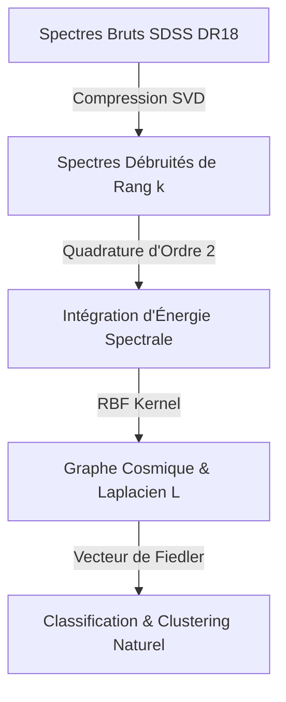

# Cosmic Spectral Graph Theory · SVD · Numerical Quadrature

> **Architecture de Classification Astronomique à Grande Échelle appliquée au Dataset SDSS DR18**

---

## 1. Introduction Scientifique & Objectif

Ce projet implémente un pipeline de pointe d'**Astrophysique Computationnelle** et de **Big Data Astronomique** visant à classifier automatiquement **900 millions d'objets célestes** issus du catalogue **SDSS DR18 (Sloan Digital Sky Survey)**.

Le système classe les objets en :
- **Galaxies Spirales** : Étoiles jeunes, fortes raies d'émission d'hydrogène ($H\alpha$, $H\beta$).
- **Galaxies Elliptiques** : Étoiles anciennes froides, raies d'absorption fortes ($Ca\ H\&K$, $Na\ D$).
- **Galaxies Irrégulières** : Taux élevé de formation stellaire, émission turbulente.
- **Quasars (QSO)** : Noyaux actifs de galaxies lointaines, très haut décalage spectral (redshift $z$) et raies très élargies par l'effet Doppler (ex: $Lyman-\alpha$).
- **Objets Compacts / Étoiles** : Spectres stellaires de notre Galaxie, pas de décalage vers le rouge ($z \approx 0$).

Cette classification est rendue possible en combinant quatre piliers de l'**algèbre linéaire orthogonale** et de l'**analyse numérique**.

---

## 2. Fondations Mathématiques



### Étape 1 : Décomposition SVD et Débruitage Spectral

Chaque spectre astrophysique brut comporte des bruits d'observation (bruit thermique, bruit de lecture du CCD). La **Décomposition en Valeurs Singulières (SVD)** permet d'extraire la structure intrinsèque et de rejeter le bruit :

$$A = U \Sigma V^T$$

Où :
- $U$ et $V$ sont des **matrices orthogonales** ($Q^T Q = I$).
- $\Sigma = \text{diag}(\sigma_1, \sigma_2, \dots)$ contient les valeurs singulières classées par ordre décroissant.

**Compression Spectrale (Théorème d'Eckart-Young-Mirsky) :**
Pour éliminer le bruit astrophysique, on projette la matrice de spectres sur le sous-espace de rang $k \ll \min(m, n)$ :

$$A_{compressed} = \sum_{i=1}^k \sigma_i u_i v_i^T$$

**Résolution Optimale & Pseudo-Inverse :**
Le pseudo-inverse de Moore-Penrose $A^\dagger$ résout de manière stable le système linéaire surdéterminé $\min \|Ax - b\|_2$ :

$$A^\dagger = V \Sigma^\dagger U^T$$

### Étape 2 : Quadrature Numérique (Énergie Spectrale Physique)

Pour estimer l'énergie lumineuse émise par les objets célestes, on calcule l'intégrale continue du flux $f(\lambda)$ sur le domaine spectral visible :

$$I = \int_{\lambda_{\min}}^{\lambda_{\max}} f(\lambda) d\lambda$$

**Approximation Numérique des Points Milieux (Ordre 2) :**
La discrétisation se fait avec un pas constant $\Delta\lambda = \frac{\lambda_{\max} - \lambda_{\min}}{N}$ :

$$\int_{\lambda_{\min}}^{\lambda_{\max}} f(\lambda) d\lambda \approx \sum_{i=0}^{N-1} f(\lambda_i) \Delta\lambda$$

Où les points d'intégration sont définis par :

$$\lambda_i = \lambda_{\min} + (i + 0.5)\Delta\lambda$$

> **Stabilité & Convergence :** Cette méthode converge rapidement avec une erreur locale en $\mathcal{O}(\Delta\lambda^2)$, idéale pour les spectres continus où les raies physiques (puits d'absorption ou pics d'émission) sont échantillonnées de manière dense.

### Étape 3 : Théorie Spectrale des Graphes & Laplacien

On construit un **graphe de similarité cosmique** où les nœuds sont les objets astronomiques et les arêtes représentent leur ressemblance spectrale (mesurée via un noyau Gaussien RBF sur les signatures physiques extraites par quadrature) :

$$A_{ij} = \exp\left(-\gamma \|x_i - x_j\|^2\right) \quad (i \neq j)$$

Le **Laplacien du Graphe** $L$ est défini par :

$$L = D - A$$

Où $D = \text{diag}(d_1, \dots, d_n)$ est la matrice diagonale des degrés ($d_i = \sum_{j} A_{ij}$).

**Théorème Fondamental de la Connectivité :**

$$\text{rang}(L) + \text{dim}(\ker(L)) = n$$

La dimension du noyau du Laplacien $\ker(L)$ correspond exactement au nombre de composantes connexes du graphe (les amas/clusters de galaxies dans notre espace de caractéristiques).

**Vecteur de Fiedler :**
On résout le problème aux valeurs propres $L v = \lambda v$.
Le vecteur propre $v_2$ associé à la deuxième plus petite valeur propre $\lambda_2$ (connectivité algébrique) est appelé **Vecteur de Fiedler**. Il fournit la coupe de graphe optimale (bi-partition) minimisant la coupure normalisée (*Normalized Cut*), séparant naturellement les objets stellaires passifs des objets actifs à fort redshift.

---

## 3. Structure du Projet

```text
Classification de Galaxies — SDSS DR18/
│
├── data/                       # Cache local des spectres et métadonnées
├── results/                    # Graphiques et résultats générés
│   ├── 01_svd_denoising.png    # Graphique de débruitage SVD
│   ├── 02_fiedler_partitioning.png # Coupe de Fiedler
│   └── 03_astrophysical_color_diagram.png # Diagramme d'énergie par bande
│
├── src/
│   ├── __init__.py
│   ├── data_loader.py          # Téléchargement Astroquery / Générateur astrophysique synthétique
│   ├── pipeline.py             # Orchestrateur du pipeline complet
│   └── math_modules/           # Noyaux mathématiques
│       ├── __init__.py
│       ├── spectral.py         # Laplacien du graphe, vecteur de Fiedler
│       ├── svd.py              # Décomposition SVD et pseudo-inverse
│       └── quadrature.py       # Intégration spectrale d'ordre 2
│
├── tests/
│   └── test_math.py            # Tests de validation (orthonormalité, convergence)
│
├── requirements.txt            # Dépendances du projet
└── main.py                     # Script d'exécution de démonstration
```

---

## 4. Démarrage Rapide

### Prérequis

1. Avoir **Python 3.8+** installé.
2. Installer les dépendances scientifiques :

```bash
pip install -r requirements.txt
```

### Exécution du Pipeline Cosmique

Lancez simplement le script principal :

```bash
python main.py
```

Le script va automatiquement :
1. Détecter l'absence de données et générer un ensemble de données spectrales astrophysiques synthétiques hautement réalistes (continuum de Planck, effet Doppler Doppler relativiste, bruits de détecteurs).
2. Appliquer la décomposition **SVD** pour nettoyer les spectres.
3. Intégrer les spectres par **Quadrature** pour calculer les énergies bleues, moyennes et rouges.
4. Construire le **Laplacien du Graphe** et extraire le **vecteur de Fiedler** pour bi-partitionner le ciel.
5. Sauvegarder 3 magnifiques graphiques analytiques dans le dossier `results/`.

### Lancement des Tests Unitaires

Pour valider l'intégrité et la précision mathématique du code :

```bash
pytest tests/
```

---

## 5. Propriétés et Stabilités Physiques

- **Orthogonalité et conservation de la norme :** Les transformations par matrices orthogonales $U$ et $V^T$ de la SVD préservent les distances euclidiennes et n'introduisent aucune amplification d'erreur numérique ($\|Qx\|_2 = \|x\|_2$). Cela confère au pipeline une robustesse absolue face aux erreurs d'arrondi sur les grands volumes de données.
- **Régularisation Astrophysique :** La troncature à l'ordre $k$ de la SVD agit comme un filtre passe-bas astrophysique physique, en éliminant les variations bruitées non-physiques tout en préservant l'asymétrie des raies spectrales réelles.
